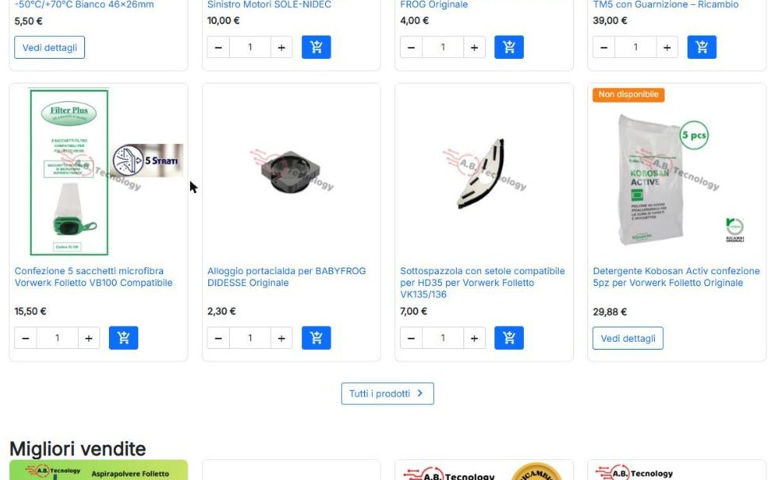
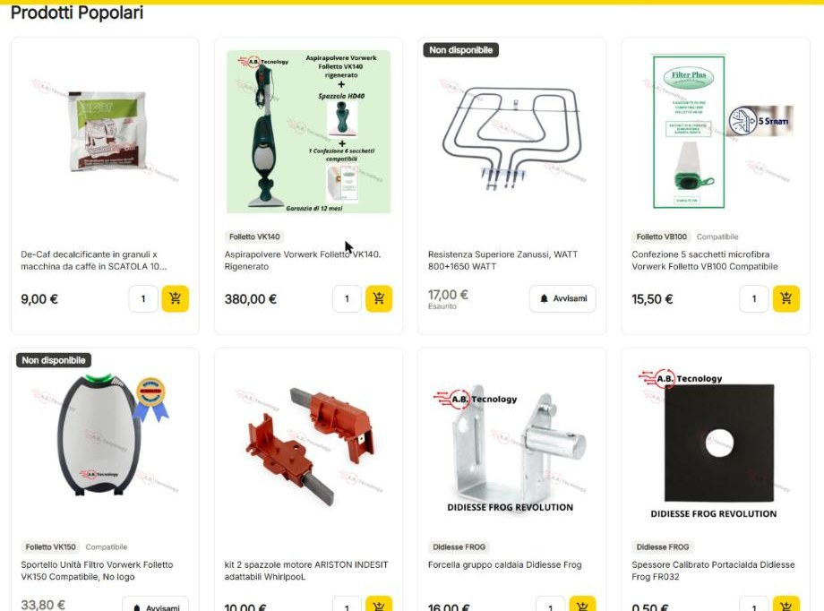
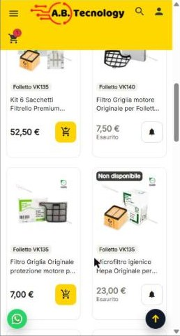
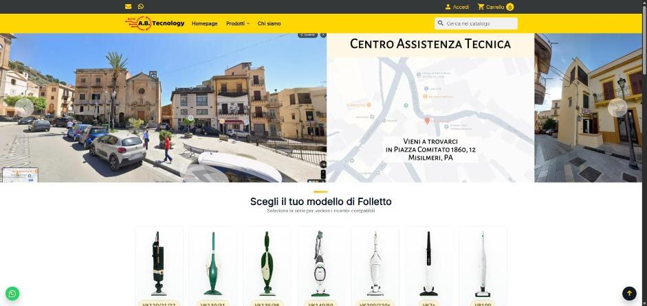
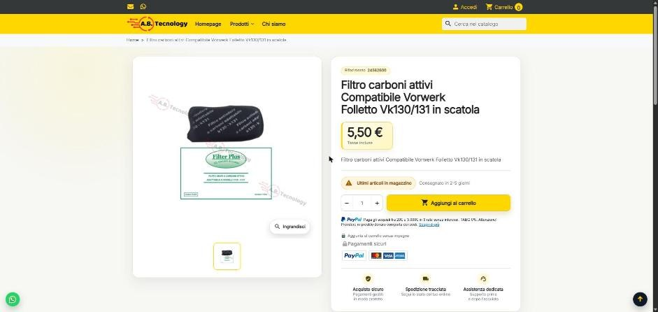

# A.B. Tecnology · e-commerce PrestaShop 9

Progettazione e realizzazione **da zero**, poi manutenzione, moduli su misura e restyling di [abtecnologyricambi.it](https://www.abtecnologyricambi.it/), negozio online di ricambi per Vorwerk Folletto e Bimby, accessori per la casa e climatizzazione (Misilmeri, Palermo).

**Stack:** PrestaShop 9.0.1 su hosting Aruba · PHP 8 · Smarty 4 · tema Hummingbird (Bootstrap 5) · CSS moderno (container query, custom properties)

> *English summary:* a PrestaShop 9 spare-parts store built from scratch on Aruba hosting, then maintained and redesigned: safe module upgrades checked against theme overrides, two custom modules (product image watermarking, back-office 2FA), a UX audit, and a redesign of product cards and site colours shipped in small, verified steps.

---

## Cosa ho fatto

### 0. Il negozio, da zero
Installazione di PrestaShop 9 sull'hosting Aruba, configurazione del tema Hummingbird, struttura delle categorie e catalogo, messa online del negozio. Tutto quello che segue è il lavoro fatto dopo il lancio, sullo stesso sito.

### 1. Aggiornamenti senza rompere il tema
15 moduli da aggiornare (alcuni a versioni maggiori: ricerca a faccette, newsletter, modulo di contatto). Prima di toccarli ho mappato gli override del tema personalizzato e letto i changelog, poi ho verificato online pagina per pagina (home, categorie, ricerca, carrello, checkout). Risultato: nessuna regressione, e i difetti trovati (form contatti assente, filtri mai configurati) risultavano già presenti nel dump del database precedente.

### 2. Moduli su misura
| Modulo | Cosa fa | Repo |
|---|---|---|
| **abwatermark** | Filigrana automatica sulle immagini prodotto (nuovi caricamenti e catalogo esistente), lavorazione a blocchi per hosting condivisi, recupero delle immagini scoperte, rimozione sicura che rigenera il catalogo pulito | [prestashop-abwatermark](https://github.com/FilippoBonanno/prestashop-abwatermark) |
| **bo2fa** | Verifica in due passaggi (TOTP, Google Authenticator) per il back office: attivazione guidata con QR generato in locale, codici di backup, dispositivi ricordati, obbligo per profilo, gate su pagine legacy e Symfony. Provato su copia Docker di PrestaShop 9, pronto per l'installazione | [prestashop-bo2fa](https://github.com/FilippoBonanno/prestashop-bo2fa) |

### 3. Analisi UX
Audit di home, card prodotto e scheda prodotto con le 10 euristiche di Nielsen (24/40 al punto di partenza) e un riferimento scelto dal cliente ([utopya.it](https://www.utopya.it/)). Problemi principali: blu di Bootstrap in conflitto con il marchio giallo/nero, card di altezze diverse con troppi controlli, foto disomogenee, compatibilità del ricambio poco visibile.

### 4. Restyling delle card prodotto
Tre varianti in mockup, scelta del cliente, poi implementazione in un unico template (`miniatures/product.tpl`) usato da tutte le liste del sito.

| Prima | Dopo |
|---|---|
|  |  |



- **Etichetta del modello** (Folletto VK135/136, Bimby TM31, Didiesse FROG) e **Originale / Compatibile** ricavate dal nome del prodotto in Smarty: nessun dato da inserire a mano su 257 prodotti.
- **Card alte uguali**: titolo su 2 righe, riga etichette sempre presente.
- **Prezzo, quantità e carrello sulla stessa riga**; sotto i 230 px di larghezza della *card* (non dello schermo) la quantità sparisce grazie a una **container query**, così funziona sia sul telefono sia sul tablet con colonna laterale.
- **Esauriti**: badge sulla foto, prezzo attenuato, pulsante "Avvisami".
- Target tattili da 44 px, focus visibile, etichette accessibili.

Il template è stato provato con un **render headless di Smarty** su nomi di prodotto reali ([tests/render-miniature.php](tests/render-miniature.php)) e verificato online a 360, 375, 768, 1024, 1280 e 1440 px, compresa l'aggiunta al carrello.

### 5. Colori del sito
Il tema usava il blu di Bootstrap (`#0d6efd`) in circa 40 regole. Sovrascrivendo le custom properties di Bootstrap ho portato tutto sul giallo/nero del marchio. Il tema usa la variabile `--bs-primary` anche per i testi, quindi il **primario diventa nero** e il **giallo resta solo sugli sfondi**: giallo su bianco non sarebbe leggibile. Titoli di sezione e newsletter sono stati uniformati.

<br clear="right">

## Com'era
| Home | Scheda prodotto |
|---|---|
|  |  |

## File
```
theme/
  templates/catalog/_partials/miniatures/product.tpl   card prodotto (override del tema)
  product.tpl.diff                                      differenze rispetto all'originale Hummingbird
  css/card-prodotto.css                                 stile delle card
  css/colori-sito.css                                   sistema colori (via il blu Bootstrap)
tests/
  render-miniature.php                                  render Smarty del template su nomi reali
```

## Metodo
Ogni modifica è passata da: analisi → mockup con varianti → scelta del cliente → implementazione → test in locale → anteprima sul sito live (solo nel browser) → pacchetto con istruzioni e file originali per il rollback → verifica online dopo il caricamento.

---
Sito realizzato e mantenuto da **Filippo Bonanno** per A.B. Tecnology, pubblicato con il consenso del cliente.
